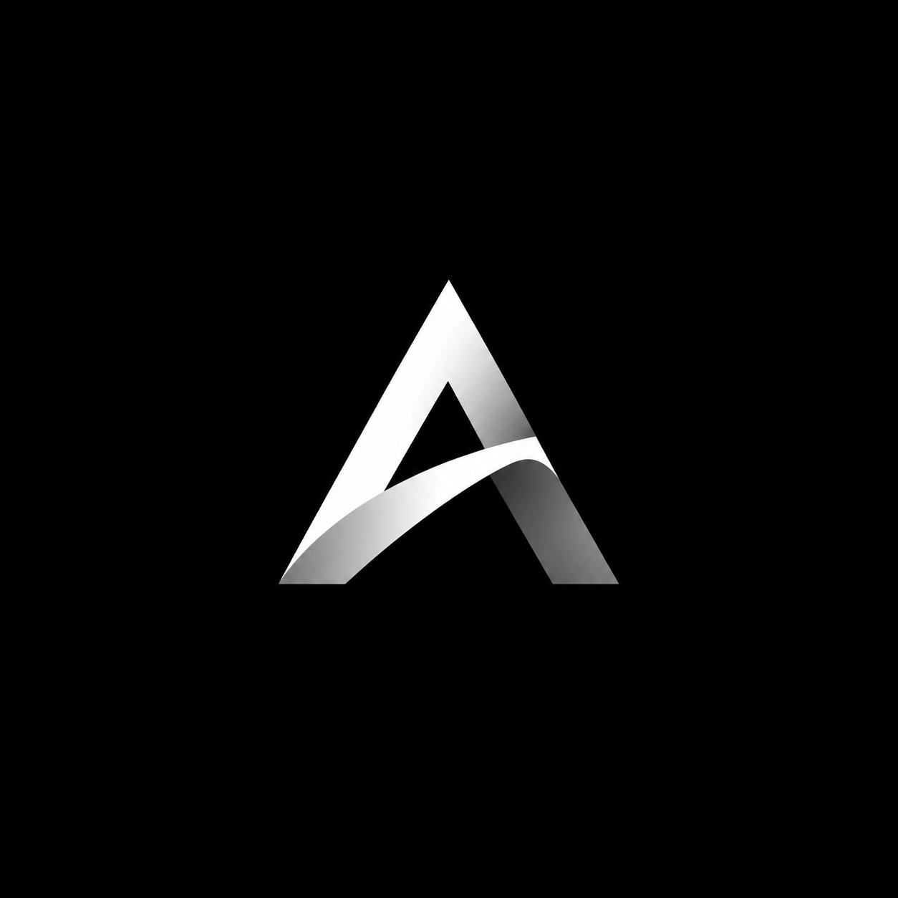
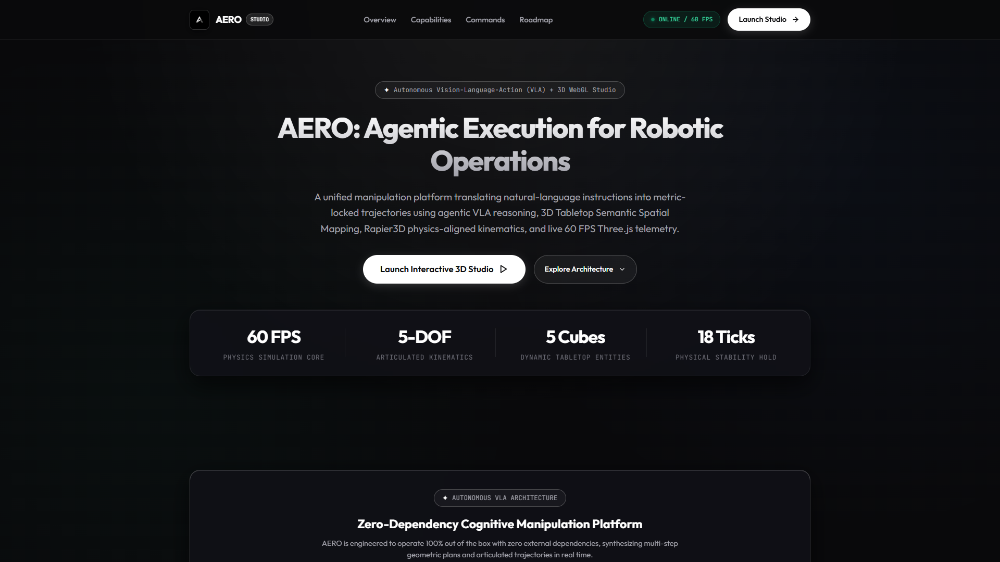
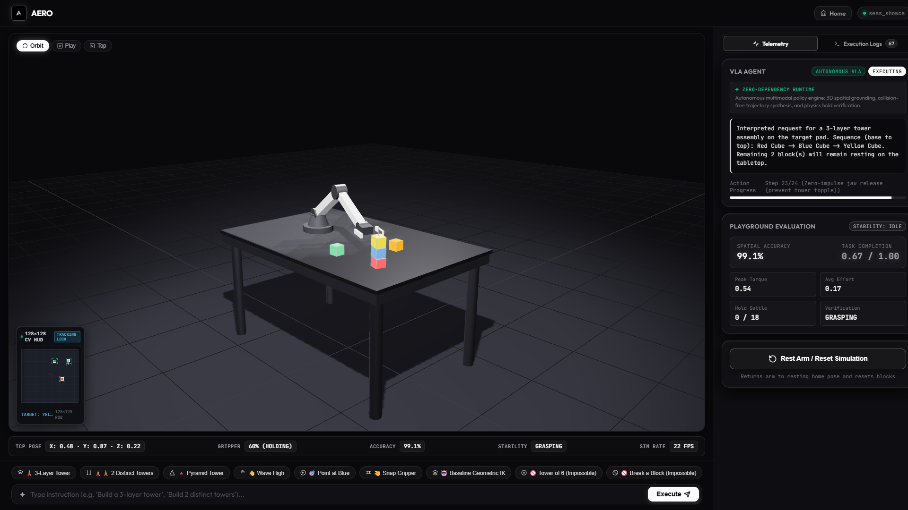
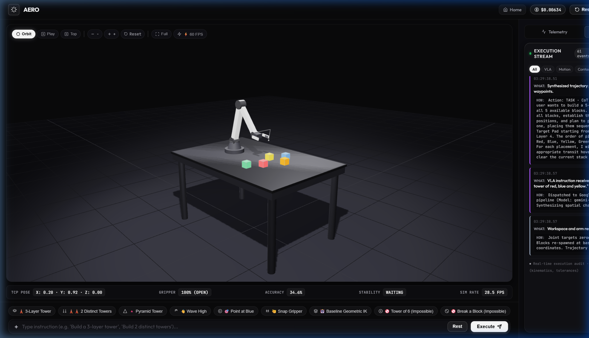
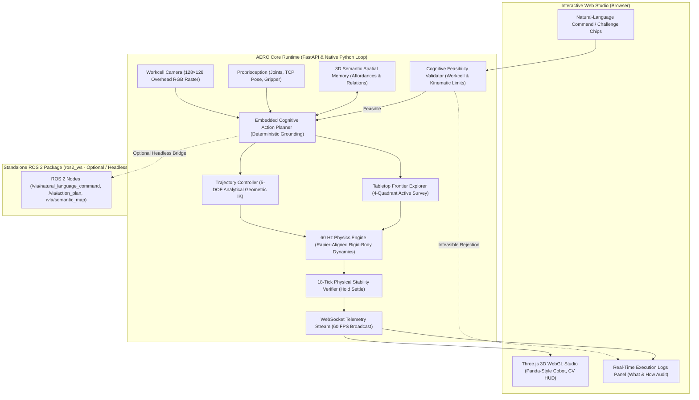

<div align="center">



# AERO: Agentic Execution for Robotic Operations

[](LICENSE)
[](https://python.org)
[](#-ros-2-ecosystem-integration-standalone-package)
[](#-key-features)
[](https://threejs.org/)
[](#-key-features)
[](SECURITY.md)

**AERO (Agentic Execution for Robotic Operations) is an end-to-end cognitive robotic manipulation platform powered by an embedded Vision-Language-Action (VLA) cognitive action planner, 3D tabletop spatial semantic mapping, frontier exploration, 60 FPS physics-aligned kinematics, multi-zone structural assembly, and an interactive Three.js WebGL studio—operating with zero cloud dependencies and running 100% locally out of the box.**

[🚀 Quick Start](#-quick-start) • [✨ Key Features](#-key-features) • [📸 Visual Showcase](#-visual-showcase) • [🗼 Multi-Tower & Pyramid](#-multi-zone--pyramid-assembly) • [💬 Natural Language Commands](#-example-natural-language-commands) • [🌐 ROS 2](#-ros-2-ecosystem-integration-standalone-package)

</div>

---

## 📸 Visual Showcase

### 🏠 AERO Home & System Portal

<div align="center">


*Modern landing portal with architecture breakdown, autonomous VLA feature breakdown, and one-click studio launch.*

</div>

### 🎮 Interactive 3D Manipulation Dashboard

<div align="center">


*Interactive Three.js 60 FPS studio featuring live robotic manipulation, multi-layer tower assembly, 128×128 CV HUD tracking reticle, and real-time physical telemetry.*

</div>

### 📋 Real-Time Execution Logs & Telemetry Stream

<div align="center">


*Audit terminal with live chronological waypoints, categorized event badges (IK Motion, Grip, Release, Verified, Completed), What/How breakdowns, and 18-tick stability hold validation.*

</div>

---

## 🌟 Architecture & System Pipeline

AERO translates high-level natural language intent into verified robotic manipulation primitives through an embedded, real-time closed-loop pipeline running 100% locally:



---

## 🗼 Multi-Zone & Pyramid Assembly

AERO extends beyond conventional single-column stacking to support multi-zone topological assemblies across designated landing coordinates:

### 1. Dual Distinct Towers (`STACK_DUAL_TOWERS`)
- **Twin Landing Zones**: Designated `STACK_ORIGIN_A` $(0.46, 0.72, 0.10)$ and `STACK_ORIGIN_B` $(0.46, 0.72, 0.32)$, spaced 22 cm apart to guarantee arm and finger clearance.
- **Cognitive Block Partitioning**: Splits available cubes into distinct subsets (e.g., Tower 1: Red & Blue; Tower 2: Yellow & Orange).
- **Collision-Free Transit Clamping**: Before moving to assemble Tower B, the arm dynamically clamps transit hover altitude ($y \ge \text{Tower A Top} + 0.10\text{ m}$) so it never strikes Tower A.
- **Physical Feasibility Check**: Prompts requesting $> 5$ cubes across towers are automatically caught and safely rejected.

### 2. Multi-Contact Pyramid Assembly (`BUILD_PYRAMID`)
- **3-Block Stepped 2D Pyramid**: Two base cubes are placed side-by-side touching flush along the Z-axis, with an apex block placed directly centered across the seam at Layer 1.
- **5-Block 3D Square Pyramid**: Four base cubes in a $2 \times 2$ grid with the fifth apex cube seated on top.
- **Zero-Impulse Contact Dwell**: Extra holding dwell ($+10$ ticks) during soft gripper release ensures base blocks remain stationary without frictional displacement.

---

## ✨ Key Features

### 1. 🤖 Embedded Cognitive VLA Engine & Action Planner
- **Zero-Cloud Deterministic Runtime**: Translates natural language instructions into metric-locked robotic action trajectories locally with **zero external API keys, zero cloud latency, and zero billing costs**.
- **Physical Feasibility Guardrails**: Cognitive pre-processing strictly evaluates commands against physical workcell affordances (maximum 5 blocks, tower reach bounds, rigid-body constraints) and immediately rejects impossible or destructive requests (e.g. towers > 5 cubes, breaking blocks, flying) with human-interpretable reasoning.
- **Visual & Spatial Grounding**: Ingests 128×128 overhead orthographic RGB frames, computer vision color-centroid segmentation, and 3D topological spatial affordance memory (`ON_TABLE`, `IN_GRIPPER`, layer tiers).
- **Optional Cloud Gemini VLA Hooks**: The codebase retains optional Google Gemini multimodal reasoning connector hooks (`gemini-2.5-flash`), but this is **not currently used or required** in standard operation—AERO runs autonomously via its embedded cognitive policy.

### 2. 📋 Real-Time Execution Logs Panel
- **Dedicated Telemetry Panel**: Live chronological feed explaining **what is happening** and **how** (e.g. *Waypoint 14/32: Soft descent to placement slot Y=0.802m · Closed jaws (100%) · Dwell: 25 ticks*).
- **Categorized Event Badges**: Color-coded badges for `IK MOTION`, `GRIP`, `RELEASE`, `EXPLORE`, and `VLA COGNITION`.

### 3. 🤖 Expressive Communicative Gestures
- **PlayScript Motion Primitives**: Communicative interactions including high wave greeting (`wave_high`), agreement nods (`nod`), gripper celebrations (`snap_gripper`), victory poses (`celebrate`), and dynamic pointing (`point_block`).

### 4. 🔬 Tabletop Frontier Exploration & 3D Spatial SLAM
- **Voxel Occupancy Mapping**: Sweeps camera trajectories across Northwest, Northeast, Southwest, and Southeast quadrants to construct 3D spatial occupancy.
- **Relational Affordance Graphs**: Continuously classifies blocks into `ON_TABLE`, `IN_GRIPPER`, and layer tiers with center-of-mass stability indices.

### 5. ⚡ 60 FPS Physics & Jitter-Free Kinematics
- **Rapier-Aligned Dynamics (Native Python)**: Implements 60 Hz rigid-body dynamics, gravity damping, table collision bounds, and stacking tolerances directly in Python matching VSArena Rapier physical specifications—with zero external simulator binaries (e.g., Gazebo) required.
- **5-DOF Geometric IK & FK**: Solves analytical joint angles with singular boundary clamping.
- **Kinematic Slerp Smoothing**: Smooth joint angle and block orientation interpolation across 60 Hz animation frames eliminates laptop frame judder.
- **Laptop Performance Mode**: Dynamic toggle between Smooth mode (DPR 1.2, optimized shadows) and High-Fidelity mode (DPR 1.75, PCF soft shadows).

---

## 🔒 Security & Privacy

> [!IMPORTANT]
> **100% Local & Zero External Data Leakage**: AERO executes entirely on your local machine without sending prompt or video telemetry to external cloud services.

1. **Zero Mandatory Credentials**: The embedded cognitive reasoning engine runs out-of-the-box with zero API keys or third-party accounts.
2. **Repository Protection**: `.gitignore` strictly blocks all `.env`, `.env.*`, `*.key`, `secrets.json`, and credentials files.
3. **Telemetry Scrubbing**: Real-time WebSocket broadcasts and server log outputs scrub any environment variables or credentials.

---

## 🏁 Quick Start

### 1. Installation

```bash
# Clone the repository
git clone https://github.com/incheif/Aero.git
cd Aero

# Create and activate virtual environment
python -m venv .venv

# Windows (PowerShell):
.venv\Scripts\Activate.ps1

# Linux / macOS:
source .venv/bin/activate

# Install dependencies
pip install -r requirements.txt
```

### 2. Configure Environment (Optional)

```powershell
cp .env.example .env
```
*(No configuration or API keys are required. The embedded cognitive action planner operates fully offline by default. If you wish to experiment with optional Google Gemini cloud reasoning, you may optionally supply a key in `.env`).*

### 3. Launch the Studio

```powershell
python run_dashboard.py
```

The server boots and launches **`http://127.0.0.1:8000`** in your browser automatically.

---

## 💬 Example Natural-Language Commands

| Category | Example Instruction | Action Performed |
| :--- | :--- | :--- |
| **Multi-Zone Stacking** | `"Make 2 distinct towers of 2 blocks each."` | Builds Tower 1 on Pad A and Tower 2 on Pad B with elevated clearance |
| **Pyramid Geometry** | `"Build a pyramid tower."` | Assembles a 3-block stepped pyramid with apex bridging |
| **Full 3D Pyramid** | `"Build a 5-block square pyramid."` | Assembles 4 cubes in a $2 \times 2$ base with a centered apex cube |
| **Multi-Layer Tower** | `"Make a 3-layer tower of red, blue and yellow."` | Stacks 3 layers in exact color order with zero-impulse drop |
| **Apex Stacking** | `"Build a 5-layer tower with all 5 blocks."` | Full workcell utilization (5 vertical layers) |
| **Visual Servoing** | `"Run ColorSeek visual servoing."` | 5 Hz RGB pixel tracker closed-loop servoing |
| **Expressive Gesture**| `"Wave high to greet me."` | 3-cycle expressive waving motion |
| **Dynamic Pointing** | `"Point at the blue cube."` | Aims TCP end-effector directly at target block coordinates |
| **Active SLAM** | `"Explore the workspace and scan table quadrants."` | 4-quadrant trajectory survey updating 3D semantic memory |
| **Feasibility Reject** | `"Build a tower of 6 blocks."` | Automatically rejects impossible request (only 5 cubes available) |

---

## 🔬 Benchmark Telemetry & Evaluation

Aero adopts the rigorous benchmarking standards from **VSArena**:
1. **18-Tick Physical Stability Hold**: After gripper release, the stack must settle and remain stationary for at least 18 consecutive physics ticks (0.30 seconds) before being verified as completed.
2. **Spatial Accuracy Metric**: Evaluates $0.7 \times \text{Position Precision} + 0.3 \times \text{Upright Orientation Alignment}$ against target slots.
3. **Kinematic Effort & Torque Telemetry**: Continuous tracking of $\sum |\Delta q| \times \text{Gain}$ with peak and average effort telemetry.

---

## 🌐 ROS 2 Ecosystem Integration (Standalone Package)

A dedicated ROS 2 package (`vla_robot_arm`) is included under `ros2_ws/`:

> [!NOTE]
> **Simulation Architecture vs. ROS 2 Role**:
> - **Active Web Studio**: The 60 Hz physics simulation, kinematics, embedded cognitive planner, and real-time Three.js WebGL visualization run autonomously in pure Python (FastAPI + WebSockets)—**ROS 2 is NOT currently used or required to run the simulation or studio**.
> - **Standalone ROS 2 Package**: For robotics engineers deploying to ROS 2 ecosystems (e.g. Humble or Iron), `ros2_ws` provides independent ROS 2 nodes that publish and subscribe over standard ROS 2 topics:

| Topic Name | Type | Description |
| :--- | :--- | :--- |
| `/vla/natural_language_command` | `std_msgs/String` | High-level natural language instructions |
| `/vla/cognitive_thought` | `std_msgs/String` | Cognitive reasoning trace and action status |
| `/vla/action_plan` | `std_msgs/String` | Synthesized waypoints and robotic action primitives |
| `/vla/semantic_map` | `std_msgs/String` | 3D Tabletop Semantic Spatial Affordance memory |
| `/vla/frontier_status` | `std_msgs/String` | Tabletop quadrant exploration metrics |

```bash
# Optional: Only needed when developing within a native ROS 2 environment
cd ros2_ws
colcon build --packages-select vla_robot_arm
source install/setup.bash
ros2 launch vla_robot_arm vla_robot_arm.launch.py
```

---

## 📂 Repository Structure

```
Aero/
├── .env.example            # Environment configuration template
├── .gitignore              # Git ignore rules for secrets and build artifacts
├── CODE_OF_CONDUCT.md      # Contributor Covenant Code of Conduct
├── CONTRIBUTING.md         # Developer contribution guidelines
├── LICENSE                 # MIT License (2026 Dhruv Gupta)
├── README.md               # Main project documentation with dynamic media
├── SECURITY.md             # Security policy and vulnerability disclosure
├── requirements.txt        # Python package dependencies
├── run_dashboard.py        # One-click dashboard entrypoint
├── docs/
│   └── assets/             # High-resolution screenshots of the updated studio
│       ├── aero_home_page.png
│       ├── aero_dashboard_studio.png
│       └── aero_execution_logs.png
├── dashboard/              # FastAPI server, WebSockets, Three.js 3D WebGL UI
│   ├── server.py           # Backend loop, execution logs, WebSocket broadcast
│   └── static/             # HTML, CSS design system, Three.js renderer
├── ros2_ws/                # Standalone ROS 2 workspace package (vla_robot_arm)
├── simulation/             # Physics engine (Rapier-aligned), kinematics (IK/FK), camera models
└── vla/                    # Embedded cognitive planner, feasibility validator, spatial mapper, controller
```

---

## 📄 License & Community Standards

- **License**: Distributed under the [MIT License](LICENSE). Copyright (c) 2026 Dhruv Gupta.
- **Code of Conduct**: Please review [CODE_OF_CONDUCT.md](CODE_OF_CONDUCT.md).
- **Contributing**: Check out [CONTRIBUTING.md](CONTRIBUTING.md) to get started with contributing.
- **Security**: Review our [SECURITY.md](SECURITY.md) for vulnerability handling and API key guidelines.
