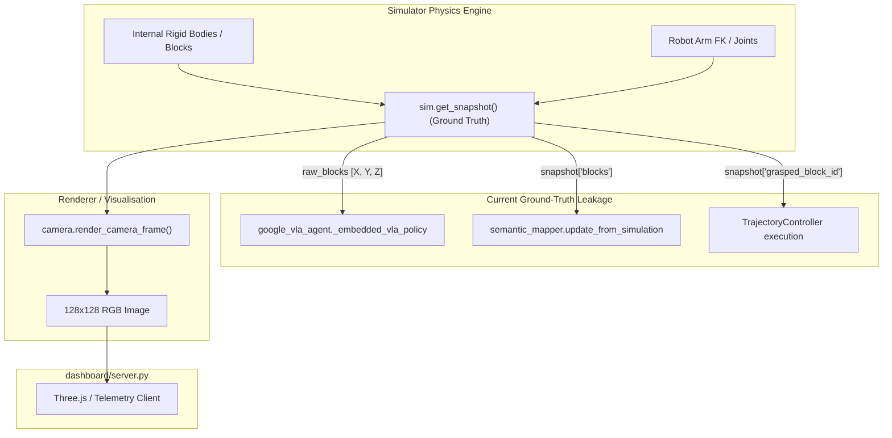

# AERO Perception, Mapping & Autonomous Manipulation Foundation Audit Report

**Date:** 2026-11-10  
**Branch:** `feat/perception-mapping-foundation`  
**Test Suite Baseline:** 19/19 tests passed (100% pass rate in 41.80s)  
**Target Architecture:** Autonomous state-estimation and closed-loop execution foundation (Workstreams A through I).

---

## 1. Executive Summary

This audit assesses the current state of the AERO robotics workcell against the perception, mapping, localisation, and closed-loop autonomous manipulation specifications defined in `AERO_perception_mapping_implementation_prompt.md`.

Currently, AERO achieves robust physical stacking, obstacle avoidance (RRT-Connect), and trajectory control. However, **the high-level planning and semantic mapping pipeline directly reads hidden simulator physics ground truth**. Specifically, `google_vla_agent.py` and `semantic_mapper.py` unpack exact Cartesian block positions `[X, Y, Z]` and block IDs directly from `snapshot["blocks"]`.

This project phase establishes a strict sensor boundary:
1. Sensor observations (RGB-D synthetic camera and joint state telemetry) are the sole inputs to perception.
2. An image-based object perception detector identifies blocks and estimates metric coordinates via calibrated coordinate transforms (`camera_frame` $\to$ `robot_base_frame`).
3. Persistent multi-object tracking and semantic mapping maintain state, stability scores, support relations, and affordances without simulator state leakage.
4. The motion planner checks collision avoidance against estimated occupancy, and closed-loop execution verifies state transitions before committing actions.
5. In accordance with Section 16, **no world models, JEPA/V-JEPA, latent dynamics, or learned MPC are implemented in this phase**.

---

## 2. Baseline Status & Current Architecture

### 2.1 Test Suite Baseline
Execution of `python -m pytest tests/ -v`:
- `tests/test_block_physics_and_collision.py`: 5 passed
- `tests/test_cartesian_motion.py`: 4 passed
- `tests/test_obstacle_avoidance_rrt.py`: 4 passed
- `tests/test_pyramid_assembly.py`: 6 passed
- **Total:** 19 passed in 41.80s (0 failures, 0 regressions).

### 2.2 Active Simulation Backends
- **Primary Backend:** Analytical physics engine (`simulation/physics_engine.py` - `RobotArmSimulation`). Table collision, block-block non-penetration, friction, and arm-block impassability are fully modeled.
- **Dynamic Backend:** MuJoCo simulation (`simulation/mujoco_engine.py` - `MujocoSimulation`). Fully supported and validated via `test_04_mujoco_dynamic_execution_avoids_tower`.

### 2.3 Current Data Flow (Ground-Truth Dependent)

---

## 3. Ground-Truth Leaks Identified in Existing Codebase

1. **`vla/google_vla_agent.py`:**
   - Lines 501–508: `raw_blocks = snapshot.get("blocks", [])`.
   - Lines 518–540: Targets for `"Pick up the yellow block"`, pyramid tiers, and block trains are computed directly from the true physical block coordinates `b["position"]`.
2. **`vla/semantic_mapper.py`:**
   - Lines 84–112: `update_from_simulation(snapshot)` iterates over `snapshot.get("blocks", [])` and copies exact IDs, positions, and categories directly into `SemanticEntity` instances.
   - Lines 87, 100: Direct usage of `snapshot.get("grasped_block_id")` and `b.get("color")`.
3. **`dashboard/server.py`:**
   - Lines 224–241: `handle_vla_command` fetches `snapshot = self.sim.get_snapshot()` and supplies it directly to `self.vla_agent.parse_instruction(cmd, img, snapshot, semantic_summary)`.
4. **`simulation/camera.py`:**
   - Functions `world_to_pixel` and `pixel_to_world` provide fixed linear scaling without explicit extrinsic/intrinsic matrix representations, camera frame structures, or synthetic depth buffers.

---

## 4. Reusable Modules and Existing Assets

- **Forward Kinematics & Jacobians (`simulation/kinematics.py`):**
  - Robust 5-DOF analytical FK (`robot_fk`), differential IK (`damped_least_squares_ik`), quaternion operations, and joint limit enforcement.
- **Collision Checking & Path Planning (`simulation/motion_planner.py`):**
  - Bi-directional RRT-Connect, adaptive altitude corridors, and swept-sphere/capsule collision checking against obstacle bounding boxes.
- **Low-Level Trajectory Controller (`vla/trajectory_controller.py`):**
  - Waypoint interpolator, transit corridor safety locking, and discrete action sequence dispatching.
- **Camera Rasterizer (`simulation/camera.py`):**
  - Clean top-down 128x128 rendering with shadows and elevation cues.

---

## 5. Workstream Gap Analysis

| Workstream | Current State | Required State | Gap Severity |
| :--- | :--- | :--- | :--- |
| **A: Camera & Sensor Abstraction** | Function `render_camera_frame(snapshot)` renders RGB without sensor abstractions. | Explicit `CameraObservation`, `CameraInterface`, `RobotStateInterface`, and `CameraCalibration`. | **High** |
| **B: Image-Based Object Perception** | None (planner reads block dictionaries). | Segmentation of RGB/depth images into bounding boxes, centroids, colors, and 3D detections. | **High** |
| **C: 3D Localisation & Coordinate Frames** | Hardcoded scaling in `camera.py`. | Formally defined `camera_frame`, `robot_base_frame`, `table_frame`, `tcp_frame` with forward/inverse transforms. | **Medium** |
| **D: Persistent Map & Tracking** | Mapper copies `snapshot["blocks"]`. | Track management, track IDs, spatial relations inferred geometrically, uncertainty decay. | **High** |
| **E: Scene Exploration** | Static scanning percentage. | Frontier / map-driven viewpoint exploration when coverage is incomplete or targets occluded. | **Medium** |
| **F: Semantic Target Grounding** | Target matched by snapshot block ID/color. | Targets resolved from natural language to tracked entities in the estimated map. | **High** |
| **G: Collision-Aware Motion Planning** | RRT exists in `motion_planner.py`, but high-level VLA generates waypoints with direct lines. | Full collision checking of all transit segments against estimated map obstacles before execution. | **Medium** |
| **H: Closed-Loop Manipulation & Verification** | Open-loop dispatch with simulator grasp flag. | Observe-act-verify cycle: visual confirmation of grasp and placement, bounded retry/recovery. | **High** |
| **I: Dashboard & Observability** | Raw snapshot telemetry. | Sensor frames, estimated tracks, uncertainty, confidence, and calibration status exposed. | **Low/Medium** |

---

## 6. Phased Implementation Roadmap

- **Stage 1 (Sensor Boundary & Calibration):**
  - Implement `simulation/sensor_interfaces.py` and `simulation/coordinate_frames.py`.
  - Refactor `simulation/camera.py` to produce `CameraObservation` (RGB + synthetic depth buffer + calibration).
- **Stage 2 (Image-Based Perception & Localisation):**
  - Create `vla/perception/` package: `detector.py`, `models.py`, `localisation.py`, `tracker.py`.
  - Write test suite `tests/test_camera_calibration.py` and `tests/test_object_perception.py`.
- **Stage 3 (Persistent Map & Tracking):**
  - Refactor `vla/semantic_mapper.py` to accept only `List[ObjectDetection]` and joint telemetry.
  - Implement geometry-based support classification and track persistence.
  - Write `tests/test_semantic_mapper_perception.py`.
- **Stage 4 (Target Grounding & Autonomous Planning Integration):**
  - Implement `vla/target_grounding.py`.
  - Refactor `vla/google_vla_agent.py` to plan exclusively from tracked map entities.
  - Route transit trajectories through collision-checked RRT paths in `simulation/motion_planner.py`.
- **Stage 5 (Closed-Loop Verification & Execution Monitor):**
  - Implement `vla/execution_monitor.py` (observe-act-verify, bounded recovery).
- **Stage 6 (Telemetry, Integration & Randomized Tests):**
  - Expose estimated tracks and confidence in `dashboard/server.py`.
  - Add randomized tabletop placement integration test in `tests/test_perception_randomized.py`.
  - Verify all 19 baseline tests + new tests pass.

