# Architectural Blueprint: 2-Level Hierarchical VL-JEPA System

> **Document Type:** System Architecture & Implementation Plan  
> **Target Subsystem:** Vision-Language-Action (VLA) & World Model Planning Stack  
> **Repository:** `AERO`  
> **Status:** Pending User Approval  

---

## 1. Executive Summary & Core Objective

In robotic tabletop manipulation (e.g., multi-box stacking into pyramids or linear trains), single-level world models and autoregressive Vision-Language Models (VLMs) encounter two fundamental bottlenecks:
1. **The 3-to-5 Step Prediction Horizon Limit:** Autoregressive image or token generation degrades rapidly beyond 4 steps due to compounding perceptual drift, hallucinations, and high computational latency (1–3 seconds per VLM call).
2. **Execution Latency & Control Disconnect:** Physical robot control (`simulation/kinematics.py`, 60 Hz physics loop) requires sub-20ms responsiveness with strict physical contact compliance.

To eliminate both bottlenecks, this proposal specifies a **Two-Level Hierarchical Joint-Embedding Predictive Architecture (H-JEPA)** coupled with a **VL-JEPA Language Grounding Layer**. Planning occurs entirely within lightweight latent embedding spaces over two decoupled timescales:
* **Level 2 (Macro-Planner):** Forecasts phase-level transitions (e.g., pick base-1, seat base-2, place apex) over large temporal jumps, conditioned on natural language goals mapped directly into latent space.
* **Level 1 (Micro-Controller):** Runs a high-rate Cross-Entropy Method (CEM) optimizer over short 3–4 step physical horizons (0.1s–1.0s) to align gripper geometry, lifting predictions into Level 2 space to check convergence against active sub-goals.

```
[ User Text Prompt: "Build a 3-block pyramid" ]
                     │
                     ▼
┌────────────────────────────────────────────────────────┐
│ LEVEL 2: High-Level Task & Sub-Goal Planner            │
│ - Timescale: Macro-steps (Phase transitions)           │
│ - Abstraction: Global scene state, box coordinates     │
│ - Output: Sequence of intermediate sub-goal embeddings │
└────────────────────────┬───────────────────────────────┘
                         │ Passes sub-goals down (z_sub^(2))
                         ▼
┌────────────────────────────────────────────────────────┐
│ LEVEL 1: Low-Level Motor & Trajectory Controller       │
│ - Timescale: Micro-steps (0.1s - 1.0s control ticks)   │
│ - Abstraction: Fine geometry, gripper-to-edge alignment│
│ - Output: Short-horizon action trajectories (CEM loop) │
└────────────────────────┬───────────────────────────────┘
                         │ Executes via Analytical IK
                         ▼
┌────────────────────────────────────────────────────────┐
│ PHYSICAL ROBOT / SIMULATION (Aero Environment)         │
└────────────────────────────────────────────────────────┘
```

---

## 2. Branching Strategy Recommendation

### Decision: **Create and Work on a Dedicated Feature Branch (`feat/hierarchical-vl-jepa`)**

We strongly recommend **not** committing directly to `main`. Instead, we should branch off `main` to `feat/hierarchical-vl-jepa`.

| Consideration | Direct `main` Commits | Feature Branch (`feat/hierarchical-vl-jepa`) | Verdict |
| :--- | :--- | :--- | :--- |
| **System Stability** | High risk of breaking working dashboard & ROS2 bridge during intermediate commits. | Zero risk to production / current demo state. | **Feature Branch** |
| **A/B Testing** | Difficult to benchmark H-JEPA against current Gemini/heuristic baseline. | Clean side-by-side benchmarking and latency comparisons. | **Feature Branch** |
| **Repository Conventions** | Violates repo pattern (previous features used `feat/multi-tower-and-pyramid`, `feat/homepage-redesign`). | Adheres strictly to the established Git workflow. | **Feature Branch** |
| **Rollback & Review** | Messy git history if latent hyperparameter tuning requires iteration. | Clean squash or fast-forward merge once verification passes. | **Feature Branch** |

**Branch Initialization Command:**
```bash
git checkout -b feat/hierarchical-vl-jepa
```

---

## 3. Mathematical Architecture & Latent Spaces

### 3.1 Latent Space Hierarchies

```
Level 2 (Macro):
  Observation s_t  ───► [ Encoder E^(2) ] ───►  z_t^(2) ∈ ℝ^{128}
                                                     │
               Macro Action a_macro^(2) ──► [ Predictor F^(2) ] ──► z_{t+ΔT}^(2)
                                                     ▲
  Language Text "Build pyramid" ──► [ Text Grounder G ] ───► z_goal^(2) ∈ ℝ^{128}

Level 1 (Micro):
  Local View o_k   ───► [ Encoder E^(1) ] ───►  z_k^(1) ∈ ℝ^{64}
                                                     │
               Micro Action a_k^(1)   ───► [ Predictor F^(1) ] ──► z_{k+1}^(1)
                                                     │
                             [ Projection Head P^(1->2) ] ──► z_lifted^(2) ∈ ℝ^{128}
                                                     │
                                                     ▼
                                          Loss: || z_lifted^(2) - z_sub^(2) ||_2
```

1. **Level 2 Macro Latent Space ($z^{(2)} \in \mathbb{R}^{128}$):**
   - Encodes topological relations, 3D centroid clusters, support-surface occupancies, and overall progress.
   - Grounded via Text Encoder $G(\text{text}) \to z^{(2)}_{\text{goal}}$.
   - Predictor $F^{(2)}(z_t^{(2)}, a_{\text{macro}}^{(2)}) \to \hat{z}_{t+\Delta T}^{(2)}$ predicts macro state transitions across phases (e.g., $\Delta T = 50\text{--}100$ control ticks).

2. **Level 1 Micro Latent Space ($z^{(1)} \in \mathbb{R}^{64}$):**
   - Encodes immediate gripper-to-target offset, approach vector, and jaw clearance.
   - Predictor $F^{(1)}(z_k^{(1)}, a_k^{(1)}) \to \hat{z}_{k+1}^{(1)}$ operates over 3–4 step local horizons (100ms–250ms).
   - Projection Head $P^{(1 \to 2)}: \mathbb{R}^{64} \to \mathbb{R}^{128}$ lifts Level 1 predictions into Level 2 latent space to compute distance to active sub-goal $z_{\text{sub}}^{(2)}$.

### 3.2 Anti-Collapse Regularization (SIGReg / VICReg)

To prevent representation collapse in joint-embedding architectures without relying on negative sample contrasts, we employ **SIGReg** (Variance-Invariance-Covariance Regularization):
$$\mathcal{L}_{\text{total}} = \mathcal{L}_{\text{pred}} + \lambda_{\text{var}} \mathcal{L}_{\text{var}} + \lambda_{\text{cov}} \mathcal{L}_{\text{cov}}$$
* **Prediction Loss:** $\mathcal{L}_{\text{pred}} = \| \hat{z}_{t+1} - z_{t+1} \|_2^2$
* **Variance Regularizer:** $\mathcal{L}_{\text{var}} = \max(0, \gamma - \sqrt{\text{Var}(z) + \epsilon})$ (forces representations to maintain variance across batches).
* **Decorrelation Loss:** $\mathcal{L}_{\text{cov}} = \frac{1}{d} \sum_{i \neq j} \text{Cov}(z)_{i,j}^2$ (forces embedding dimensions to capture independent physical features).

---

## 4. Planning Algorithm: Decoupled Cross-Entropy Method (CEM)

Both levels utilize the Cross-Entropy Method (CEM) operating in their respective latent spaces. Because evaluations occur through forward matrix multiplications in latent space rather than generating pixels or autoregressive tokens, **inference completes in $< 5\text{ ms}$**.

### Level 2 Macro-CEM
* **Sampling Distribution:** $\mathcal{N}(\mu^{(2)}, \Sigma^{(2)})$ over macro-action parameters (which cube, target coordinate offset, placement layer).
* **Horizon:** $H^{(2)} = 3\text{ phases}$ (e.g. Pyramid: [Place Base Left] $\to$ [Place Base Right] $\to$ [Place Apex]).
* **Cost Function:**
  $$J^{(2)}(a_{1:H}^{(2)}) = \| \hat{z}_{H}^{(2)} - z_{\text{goal}}^{(2)} \|_2 + \alpha \cdot \text{FeasibilityPenalty}$$
* **Output:** Sequence of sub-goals $\{ z_{\text{sub}, 1}^{(2)}, z_{\text{sub}, 2}^{(2)}, \dots, z_{\text{sub}, H}^{(2)} \}$.

### Level 1 Micro-CEM
* **Sampling Distribution:** $\mathcal{N}(\mu^{(1)}, \Sigma^{(1)})$ over $\Delta\text{TCP} \in \mathbb{R}^3$ and gripper state $\in [0, 1]$.
* **Horizon:** $H^{(1)} = 4\text{ micro-steps}$ ($0.1\text{s}$ per step).
* **Cost Function:**
  $$J^{(1)}(a_{1:H}^{(1)}) = \| P^{(1 \to 2)}(\hat{z}_{H}^{(1)}) - z_{\text{sub}}^{(2)} \|_2 + \beta \cdot \text{SmoothnessPenalty}(\Delta a)$$
* **Output:** Optimal 4-step action trajectory, with the first action $a_0^{(1)}$ dispatched to `simulation/kinematics.py`.

---

## 5. Elimination of False Positives & Drift Bounding

1. **Dual Latent + Physical Gate:**
   - Level 1 does not transition to the next Level 2 macro-step based on guesswork.
   - Transition condition:
     $$\| P^{(1 \to 2)}(z_t^{(1)}) - z_{\text{sub}}^{(2)} \|_2 < \epsilon_{\text{latent}} \quad \text{AND} \quad \text{ScoringSuite.verify\_subgoal\_physical}() == \text{True}$$
   - Leverages `simulation/scoring.py` stability hold ($18\text{ ticks} = 0.30\text{s}$) to physically verify resting contact.
2. **Hierarchical Re-Anchoring:**
   - At each macro-step boundary, Level 2 re-observes the true physical state from `simulation/camera.py` and `vla/semantic_mapper.py`, resetting any micro-scale compounding error back to zero.

---

## 6. Codebase Integration Points in Aero

| File Path | Role in Hierarchical VL-JEPA Pipeline |
| :--- | :--- |
| `vla/h_jepa/` *(New Package)* | Houses core H-JEPA modules: `encoders.py`, `predictors.py`, `vl_grounder.py`, `cem_planner.py`, `orchestrator.py`. |
| `vla/instruction_interpreter.py` | Maps user text prompts ("build a pyramid") into high-level task specifications, interfacing with `vl_grounder.py`. |
| `vla/semantic_mapper.py` | Supplies 3D bounding boxes and topological relations into Level 2 observation encoder $E^{(2)}$. |
| `simulation/camera.py` | Feeds visual top-down and TCP camera frames to Level 1 visual encoder $E^{(1)}$. |
| `simulation/kinematics.py` | Executes micro-actions via analytical 5-DOF IK with altitude and joint limit enforcement. |
| `simulation/scoring.py` | Provides deterministic geometric convergence and stability hold verification before sub-goal advancement. |
| `vla/google_vla_agent.py` | Integrates H-JEPA as a selectable cognitive mode (`"h_jepa"`) alongside `"embedded"` and `"live_cloud"`. |
| `dashboard/` | Exposes real-time telemetry: Level 2 macro plan, active sub-goal embedding distance, and Level 1 CEM elite rollouts. |

---

## 7. Implementation Roadmap & Phased Milestones

```mermaid
gantt
    title Hierarchical VL-JEPA Implementation Phases
    dateFormat  X
    axisFormat %d
    section Phase 1
    Git Branch & Encoders/Predictors Setup :0, 2
    section Phase 2
    CEM Planners & Latent Cost Engines     :2, 4
    section Phase 3
    Aero Kinematics & Scoring Integration  :4, 6
    section Phase 4
    Multi-Box Pyramid Stacking Verification:6, 8
    section Phase 5
    Dashboard Telemetry & Documentation    :8, 10
```



### Phase 1: Branch Setup & Core H-JEPA Module Architecture
* Create git branch `feat/hierarchical-vl-jepa`.
* Create `vla/h_jepa/` directory structure with:
  - `encoders.py`: Level 1 & Level 2 observation & action encoders.
  - `predictors.py`: Latent world model transition predictors $F^{(1)}$ and $F^{(2)}$.
  - `regularization.py`: SIGReg/VICReg variance & covariance functions.
  - `vl_grounder.py`: Language-to-latent goal projection.

### Phase 2: Decoupled CEM Planners
* Implement `cem_planner.py`:
  - Vectorized Level 1 Micro-CEM (population size $N=64$, elites $K=8$, horizon $H=4$).
  - Level 2 Macro-CEM (discrete/continuous phase candidate evaluation, horizon $H=3$).
  - Latent distance scoring with projection head $P^{(1 \to 2)}$.

### Phase 3: Kinematics & Simulation Closed-Loop Integration
* Implement `orchestrator.py`:
  - Ties `InstructionInterpreter` $\to$ Level 2 Sub-Goal sequence $\to$ Level 1 CEM loop.
  - Connects Level 1 outputs directly to `TrajectoryController` and `simulation/kinematics.py`.
  - Integrates `simulation/scoring.py` `StabilityValidator` for strict sub-goal gate transitions.

### Phase 4: Benchmark & Pyramid Stacking Verification
* Implement automated benchmark test `test_h_jepa_pyramid.py`:
  - 3-Block Stepped Pyramid (2 base + 1 apex).
  - 5-Block Square Pyramid (4 base + 1 apex).
  - 6-Block Stepped Pyramid (3 base + 2 mid + 1 apex).
* Measure metrics:
  - Macro-step convergence rate.
  - CEM step latency (target: $< 15\text{ ms}$).
  - Stability hold verification (zero false positives).

### Phase 5: Dashboard Telemetry & Final Merge
* Add visual telemetry stream for H-JEPA (macro sub-goals, latent distance residual, CEM elite rollouts).
* Update documentation and merge `feat/hierarchical-vl-jepa` into `main` via PR.

---

## 8. Verification Criteria & Success Metrics

1. **Step Horizon Robustness:** Successfully plan and execute up to 6 sequential block placements without compounding drift or VLA context limits.
2. **Latency:** Level 1 micro-planning step latency $< 20\text{ ms}$ (compatible with 60 Hz simulation loop).
3. **Task Completion Accuracy:** 100% physically stable pyramid structures verified by `simulation/scoring.py` with 18-tick resting hold.
4. **False Positive Rate:** 0% premature sub-goal advancements.
